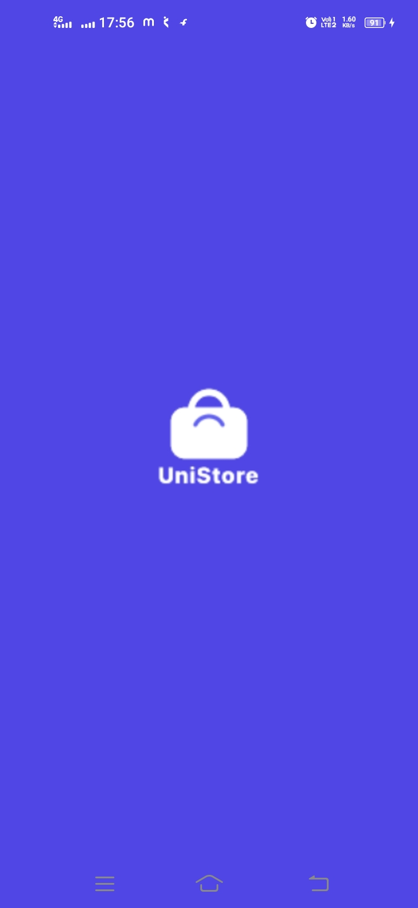
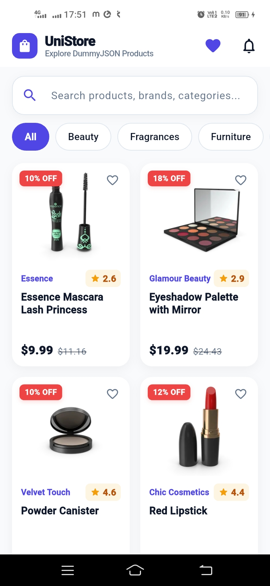
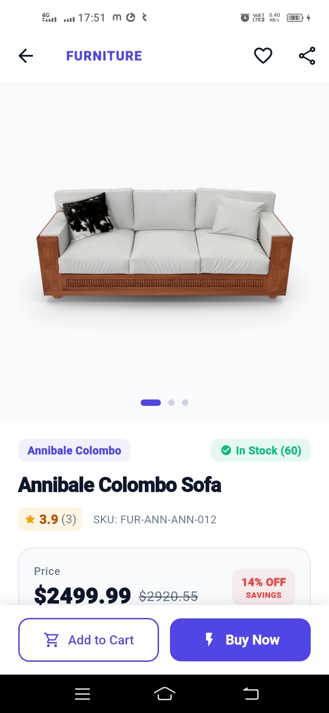
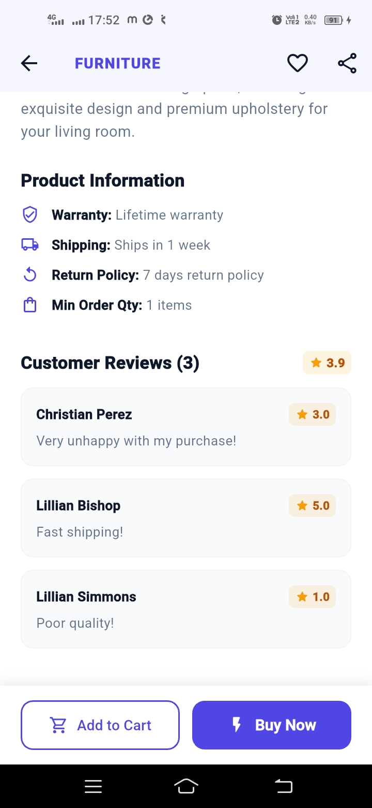
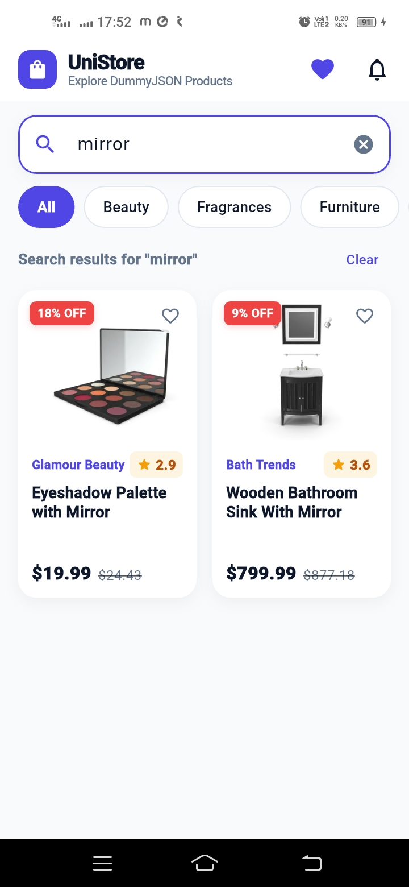
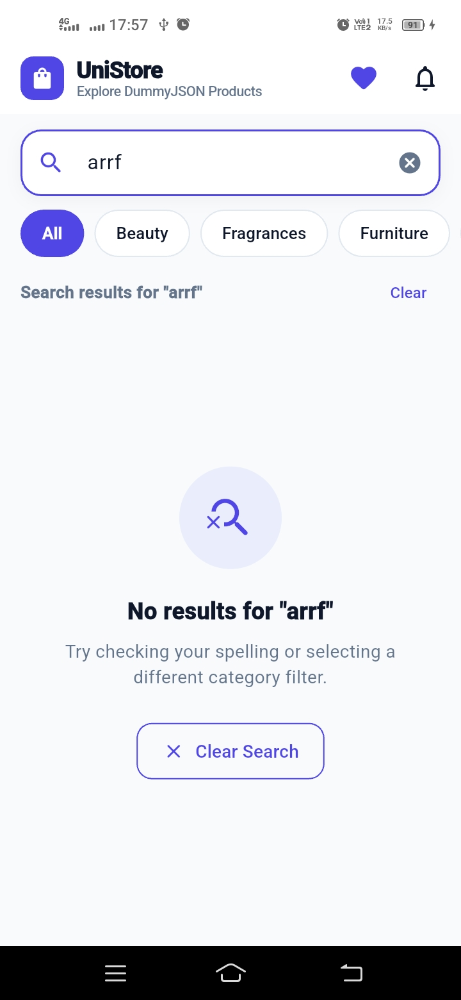

# UniStore - Flutter Product Catalog

A Flutter e-commerce product catalog application built for the Go UniCrew technical evaluation. The app fetches products from the DummyJSON API and implements clean architecture, reactive state management with Riverpod, declarative routing with GoRouter, and a branded splash experience.

---

## Screenshots

| Splash Screen | Product Catalog | Product Detail | Reviews & Specs | Search Results | Empty State |
| :---: | :---: | :---: | :---: | :---: | :---: |
|  |  |  |  |  |  |

---

## Features

- **Branded Splash Screen**:
  - Pure white **UniStore** brand emblem badge, bold brand title, and letter-spaced subtitle on vibrant `#4F46E5` background.
  - Native launch configuration for Android (including Android 12+ Splash API with `values-v31` styles and bounded fallback drawables) and iOS storyboard.
  - In-engine Flutter `SplashScreen` fallback with subtle entry animation and instant frame-synchronized native splash dismissal for zero flicker across all OEM devices (e.g. Vivo, Oppo, Xiaomi, Samsung).
- **Product Listing**: 2-column responsive grid showing product thumbnail, title, rating, current price, original price, and discount percentage badge.
- **Search Functionality**: Search with 350ms debounce against DummyJSON's search API, including clear button and empty-state screen with quick reset.
- **Category Filter**: Dynamically populated horizontal filter chips from the categories endpoint.
- **Pull-to-Refresh**: Native `RefreshIndicator` integrated with Riverpod provider invalidation.
- **Shimmer Loading & Error Handling**: Skeleton shimmer cards during fetch operations, along with retryable error screens for offline/timeout scenarios.
- **Product Details Screen**:
  - Hero image animation from listing card.
  - Multi-image swipeable gallery with pagination dots.
  - Stock badge (`In Stock` / `Low Stock` with quantity).
  - Specifications breakdown (SKU, Warranty, Shipping, Return Policy, Minimum Order Quantity).
  - Customer reviews list with reviewer name, star rating, and feedback comment.
  - Sticky bottom action bar with `SafeArea` padding.
- **Favorites**: In-memory favorite toggle per product with app bar badge counter.

---

## Architecture & Project Structure

The project uses a **Feature-First** structure with strict 3-layer separation (**Presentation**, **Domain**, **Data**):

### Layers

| Layer | Responsibility | Components |
| :--- | :--- | :--- |
| **Presentation** | Displays UI and manages UI state | Screens, widgets, Riverpod Notifiers & FutureProviders |
| **Domain** | Pure business logic and use cases | Entities (`Product`, `Review`), repository interface (`ProductRepository`), and use cases (`GetProductsUseCase`, `SearchProductsUseCase`, `GetProductDetailUseCase`, `GetCategoriesUseCase`) |
| **Data** | Fetches and deserializes remote data | DTO models with mapping (`ProductDto`, `ReviewDto`), API service (`ProductApiService`), repository implementation (`ProductRepositoryImpl`) |

### Folder Structure

```text
lib/
├── core/
│   ├── constants/
│   │   └── api_constants.dart          # Base URL, endpoints, and timeouts
│   ├── network/
│   │   ├── api_client.dart             # HTTP client wrapper with exception mapping
│   │   └── api_exception.dart          # Custom exception classes
│   ├── routing/
│   │   ├── app_router.dart             # GoRouter setup with deep-link handling
│   │   └── app_routes.dart             # Route path definitions
│   ├── theme/
│   │   └── app_theme.dart              # Colors, typography, and Material 3 theme
│   └── widgets/
│       ├── custom_network_image.dart   # Image widget with placeholder and error fallback
│       ├── empty_state_widget.dart     # Empty search/filter illustration view
│       ├── error_state_widget.dart     # Error message with retry button
│       ├── loading_shimmer.dart        # Shimmer skeleton loader
│       └── rating_badge.dart           # Rating pill badge
│
├── features/
│   ├── splash/
│   │   └── presentation/
│   │       └── screens/
│   │           └── splash_screen.dart  # Branded UniStore splash screen
│   │
│   └── products/
│       ├── data/
│       │   ├── models/                 # Data transfer objects with .toDomain()
│       │   ├── repositories/           # ProductRepositoryImpl
│       │   └── services/               # ProductApiService (http calls)
│       ├── domain/
│       │   ├── entities/               # Pure domain entities (Product, Review)
│       │   ├── repositories/           # ProductRepository interface
│       │   └── use_cases/              # Single-purpose use cases
│       └── presentation/
│           ├── providers/              # Riverpod state providers and notifiers
│           ├── screens/                # ProductListScreen, ProductDetailScreen
│           └── widgets/                # ProductCard, SearchBarWidget, CategoryFilterBar, ImageGallerySlider
│
└── main.dart                           # ProviderScope and MaterialApp.router setup
```

---

## State Management (Riverpod)

The application utilizes `flutter_riverpod` (v3.x `Notifier` pattern):

- **`searchQueryProvider`**: `NotifierProvider<SearchQueryNotifier, String>` holding the current search query.
- **`selectedCategoryProvider`**: `NotifierProvider<SelectedCategoryNotifier, String?>` holding the active category filter.
- **`productsListProvider`**: `FutureProvider<List<Product>>` that listens to `searchQueryProvider` and `selectedCategoryProvider`. It fetches filtered or searched data automatically and supports pull-to-refresh via `ref.refresh(productsListProvider.future)`.
- **`categoriesProvider`**: `FutureProvider<List<String>>` for the categories chip bar.
- **`productDetailProvider`**: `FutureProvider.family<Product, int>` used when navigating directly by ID / deep link.
- **`favoritesProvider`**: `NotifierProvider<FavoritesNotifier, Set<int>>` managing favorited product IDs.

---

## Routing (GoRouter)

- Declarative routing using `go_router`:
  - `/` &rarr; `SplashScreen` (navigates automatically to `/products` after 1.8s)
  - `/products` &rarr; `ProductListScreen`
  - `/products/:id` &rarr; `ProductDetailScreen`
- Supports passing the `Product` entity via `extra` for immediate transitions when tapping a card.
- Supports fallback fetching via `productDetailProvider(id)` when navigating directly via URL or deep link.

---

## Getting Started

### Prerequisites
- Flutter SDK (v3.16.0 or higher)
- Target device: Android emulator/device, iOS simulator/device, macOS desktop, or Chrome

### Installation & Run

1. Clone or extract the repository:
   ```bash
   cd go_unicrew_task
   ```

2. Fetch dependencies:
   ```bash
   flutter pub get
   ```

3. Run static analysis:
   ```bash
   flutter analyze
   ```

4. Run unit and widget tests:
   ```bash
   flutter test
   ```

5. Run the app:
   ```bash
   flutter run
   ```

   To run on a specific platform:
   ```bash
   flutter run -d chrome
   # or
   flutter run -d macos
   ```

---

## API Reference

The app communicates with the [DummyJSON Products API](https://dummyjson.com/docs/products):
- **All Products**: `GET /products?limit=50&skip=0`
- **Search**: `GET /products/search?q={query}`
- **Categories**: `GET /products/categories`
- **Category Filter**: `GET /products/category/{category}`
- **Product Details**: `GET /products/{id}`
