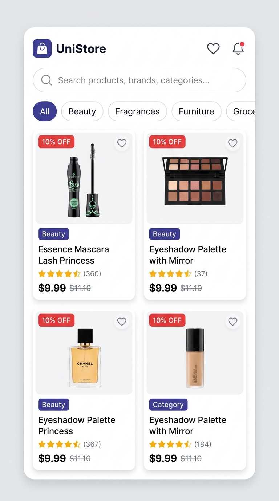
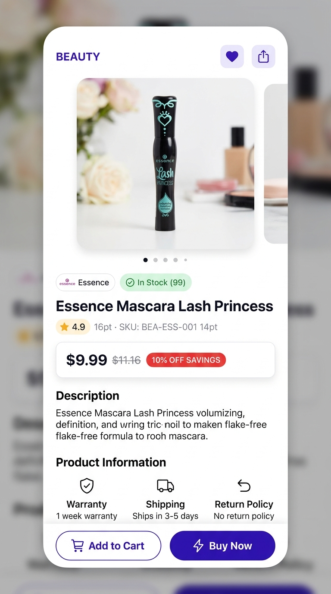
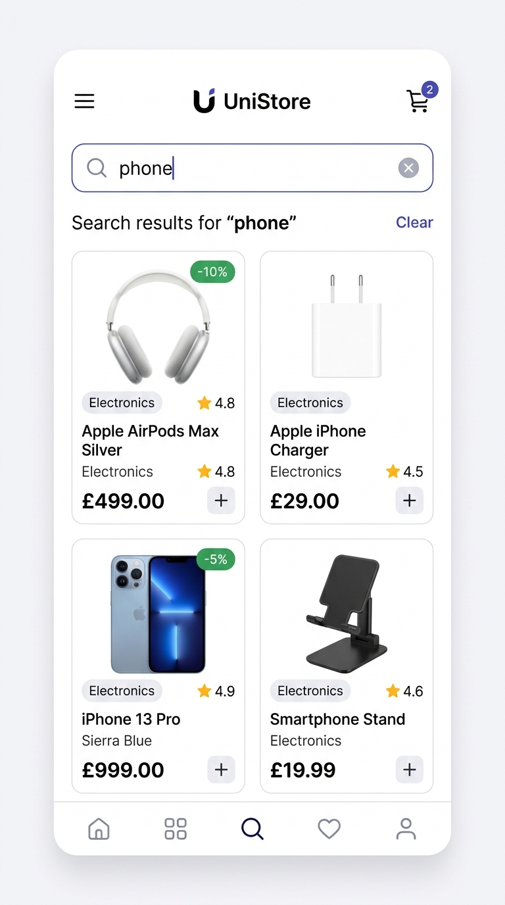

# 🛍️ UniStore - Flutter Product Catalog App

A modern, responsive, and robust Flutter e-commerce product catalog application built using **Flutter**, **Riverpod 3.x**, and the **DummyJSON Products API**.

---

## 📱 Screenshots

| Product Listing & Categories | Product Detail & Reviews | Real-time Search & Filter |
| :---: | :---: | :---: |
|  |  |  |

---

## 🚀 Key Features

- **🌐 DummyJSON API Integration**: Fetches real-time products, categories, and search results using `http` and clean API abstraction layers.
- **🖼️ High-Quality Product Display**: Displays product images with aspect ratio preservation, loading placeholders, error fallbacks, title, brand/category, star rating, current price, and struck-through original price with calculated discount percentage badges.
- **🔍 Real-Time Search**: Debounced search input (350ms) querying `https://dummyjson.com/products/search?q={query}` with instantaneous clear button (`X`).
- **🏷️ Dynamic Category Filtering**: Horizontal chip filter bar populated dynamically from DummyJSON categories endpoint.
- **🔄 Pull-to-Refresh**: Native `RefreshIndicator` seamlessly wired to Riverpod's asynchronous provider invalidation/refresh.
- **⏳ Skeleton Shimmer Loading**: Elegant animated pulsing shimmer skeleton cards during asynchronous data fetching.
- **⚠️ Comprehensive Error & Offline Handling**: Gracefully handles network timeouts, socket exceptions (no internet), and server errors with a user-friendly "Try Again" retry action.
- **🔍 Empty Results State**: Informative fallback UI when search yields no products, with a quick "Clear Search" button.
- **📄 Full Product Detail Screen**:
  - Hero image animation from card to detail view.
  - Multi-image swipeable carousel with indicator dots.
  - Stock availability badges (`In Stock` / `Low Stock` with item counts).
  - Price breakdown card with calculated savings.
  - Full product description.
  - Product specifications (SKU, Warranty, Shipping, Return Policy, Minimum Order Quantity).
  - Customer reviews section with ratings, user names, and comments.
  - Sticky bottom action bar with "Add to Cart" and "Buy Now" buttons.
- **❤️ Favorites Support**: In-memory favorite toggling per product with reactive app bar counter.

---

## 🏗️ Architecture & Project Structure

The project strictly follows **Feature-First Architecture** (Feature-driven / Clean Architecture by feature):

```text
lib/
├── core/                               # Core shared foundation
│   ├── constants/
│   │   └── api_constants.dart          # Base URLs, API endpoints, timeouts
│   ├── network/
│   │   ├── api_client.dart             # HTTP client wrapper with error interceptors
│   │   └── api_exception.dart          # Custom typed network & API exceptions
│   ├── theme/
│   │   └── app_theme.dart              # Custom design system, typography & colors
│   └── widgets/                        # Shared reusable UI widgets across all features
│       ├── custom_network_image.dart   # Image loader with progress & fallback
│       ├── empty_state_widget.dart     # Friendly empty search/filter view
│       ├── error_state_widget.dart     # Retryable network error view
│       ├── loading_shimmer.dart        # Pulsing skeleton loading grid
│       └── rating_badge.dart           # Star rating & review count pill
│
├── features/
│   └── products/                       # Products Feature (Catalog, Detail, Search, Filtering)
│       ├── data/
│       │   ├── models/
│       │   │   ├── product_model.dart      # Product domain/API model with helpers
│       │   │   ├── products_response.dart  # Paginated response wrapper
│       │   │   └── review_model.dart       # Customer review data model
│       │   ├── repositories/
│       │   │   └── product_repository.dart # Single source of truth for products data
│       │   └── services/
│       │       └── product_api_service.dart# Raw HTTP requests to DummyJSON endpoints
│       └── presentation/
│           ├── providers/
│           │   └── product_providers.dart  # Riverpod providers (products, search, categories, favorites)
│           ├── screens/
│           │   ├── product_list_screen.dart    # Main screen with search, categories & grid
│           │   └── product_detail_screen.dart  # Detail screen with gallery, specs & reviews
│           └── widgets/
│               ├── category_filter_bar.dart    # Category chip bar
│               ├── image_gallery_slider.dart   # Swipeable image carousel with dots
│               ├── product_card.dart           # Product grid item card
│               └── search_bar_widget.dart      # Debounced search bar with clear button
│
└── main.dart                           # App entry point with ProviderScope & MaterialApp
```

---

## ⚡ State Management (Riverpod)

The application uses `flutter_riverpod` (v3.x / modern `Notifier` pattern):

1. **`productRepositoryProvider`**: Injects `ProductRepository` backed by `ProductApiService` and `ApiClient`.
2. **`searchQueryProvider`**: A `NotifierProvider<SearchQueryNotifier, String>` holding the active search query.
3. **`selectedCategoryProvider`**: A `NotifierProvider<SelectedCategoryNotifier, String?>` managing active category filters.
4. **`productsListProvider`**: A `FutureProvider<List<ProductModel>>` that automatically refetches whenever the search query or category filter changes, and smoothly invalidates on pull-to-refresh (`ref.refresh(productsListProvider.future)`).
5. **`categoriesProvider`**: A `FutureProvider<List<String>>` fetching available categories from the API.
6. **`favoritesProvider`**: A `NotifierProvider<FavoritesNotifier, Set<int>>` maintaining favorited item IDs.

---

## 🛠️ Setup & Run Instructions

### Prerequisites
- [Flutter SDK](https://flutter.dev/docs/get-started/install) (v3.16.0 or higher, tested on Flutter 3.41.6 / Dart 3.11.4)
- Supported target: Android, iOS, macOS, or Chrome / Web.

### 1. Clone & Navigate
```bash
cd /path/to/go_unicrew_task
```

### 2. Install Dependencies
```bash
flutter pub get
```

### 3. Verify Code Quality & Static Analysis
```bash
flutter analyze
```
*(Result: `No issues found!`)*

### 4. Run Unit and Widget Tests
```bash
flutter test
```
*(Result: `All 6 tests passed!`)*

### 5. Launch the Application

#### Run on Mobile (Android / iOS):
```bash
flutter run
```

#### Run on Chrome (Web):
```bash
flutter run -d chrome
```

#### Run on macOS (Desktop):
```bash
flutter run -d macos
```

---

## 📡 API Reference

This app consumes the **DummyJSON Products API**:
- **Products List**: `GET https://dummyjson.com/products?limit=50&skip=0`
- **Product Search**: `GET https://dummyjson.com/products/search?q={query}`
- **Product Categories**: `GET https://dummyjson.com/products/categories`
- **Products by Category**: `GET https://dummyjson.com/products/category/{category}`
- **Product Details by ID**: `GET https://dummyjson.com/products/{id}`

---

## 🧪 Testing Summary

The test suite covers:
1. `ReviewModel` JSON parsing and fallback handling.
2. `ProductModel` JSON parsing, discount calculation, and currency formatting.
3. `ProductsResponse` pagination and list unwrapping.
4. `ProductListScreen` widget rendering with mock `ProviderScope` overrides.
5. `ProductCard` interaction and price display.
6. `ProductDetailScreen` rendering, specification tiles, and action buttons.
